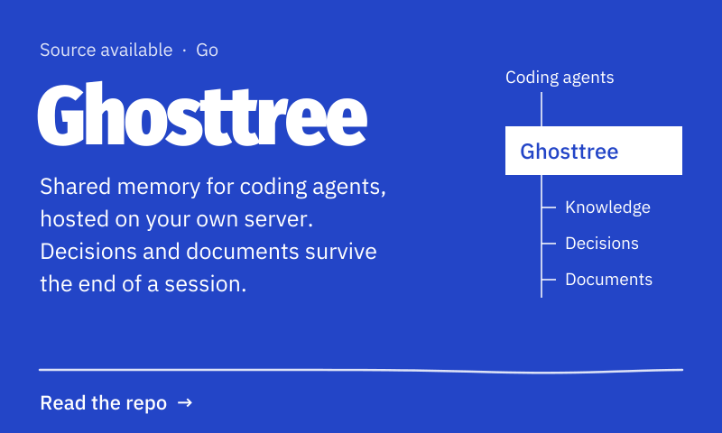
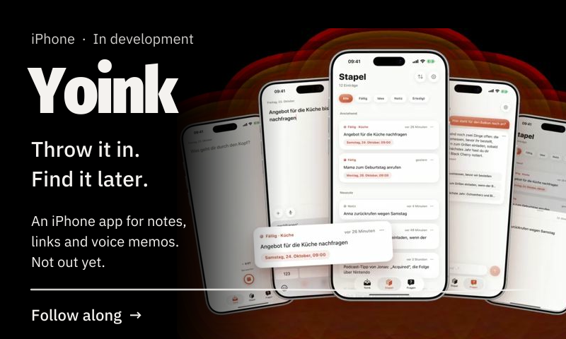
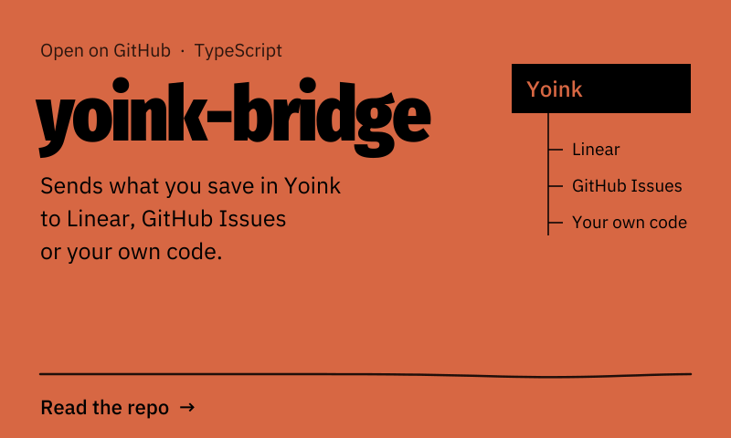
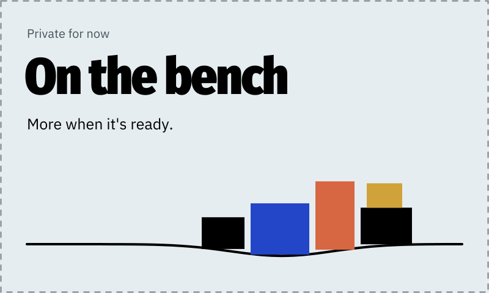
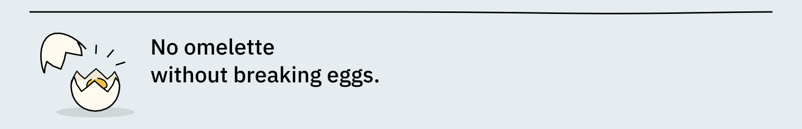

<picture>
  <source media="(prefers-color-scheme: dark)" srcset="https://raw.githubusercontent.com/Deadweight-Labs/.github/main/profile/assets/banner-dark.svg">
  
</picture>

This is where our code lives. Most of it stays private until it works. What's public is below.

<picture><source media="(prefers-color-scheme: dark)" srcset="https://raw.githubusercontent.com/Deadweight-Labs/.github/main/profile/assets/card-bench-dark.svg"></picture>

Bugs and ideas: open an issue in the repo. 
Security issues: [security@deadweightlabs.com](mailto:security@deadweightlabs.com), please not in public. 
Everything else: [team@deadweightlabs.com](mailto:team@deadweightlabs.com)

<picture>
  <source media="(prefers-color-scheme: dark)" srcset="https://raw.githubusercontent.com/Deadweight-Labs/.github/main/profile/assets/footer-dark.svg">
  
</picture>
